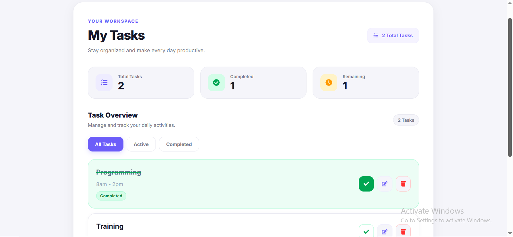
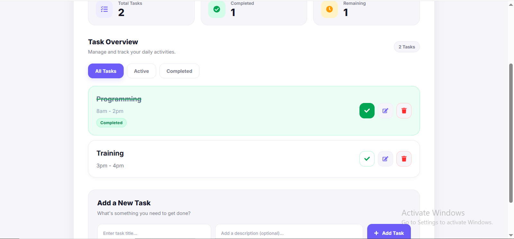
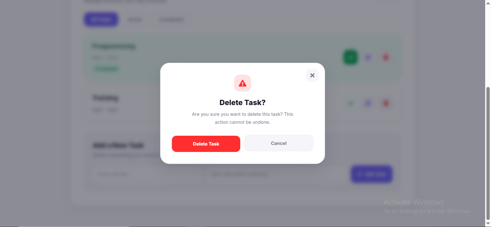
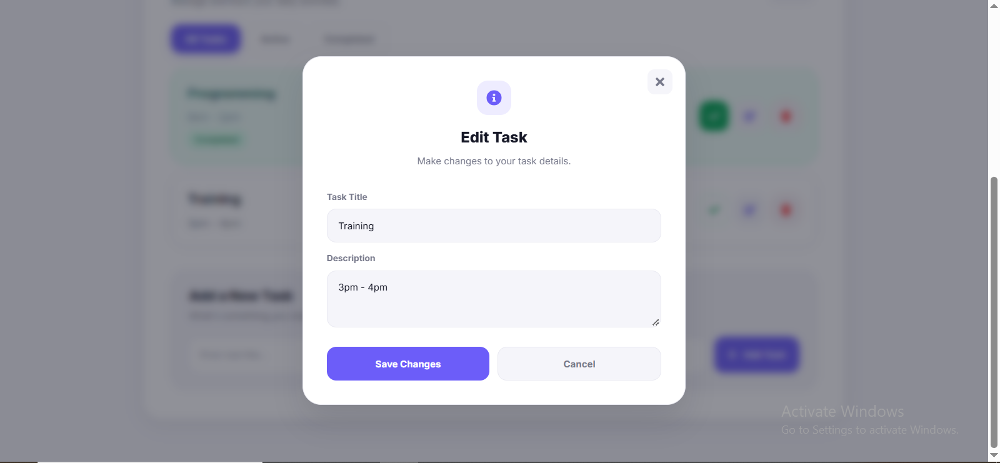

# Taskly | Task Management App

A simple and intuitive task management application built with React. Taskly helps users organize their daily tasks, track progress, and stay productive through a clean and user-friendly interface.

## ✨ Features

- **Add Tasks:** Create new tasks and organize daily activities.
- **Edit Tasks:** Update existing task details whenever needed.
- **Delete Tasks:** Remove tasks you no longer need.
- **Task Completion:** Mark tasks as completed or active.
- **Task Filtering:** Filter tasks by All, Completed, and Active.
- **Local Storage:** Persist tasks in the browser so they remain available after refreshing the page.
- **Toast Notifications:** Get feedback when performing task actions.
- **Context API:** Manage application state using React Context.

## 📸 Screenshots

### Main Interface



### Task Management



### Delete Task Dialog



### Update Task Dialog



## 🛠️ Tech Stack

| Technology        | Purpose                       |
| ----------------- | ----------------------------- |
| React 19          | Building the user interface   |
| JavaScript (ES6+) | Application logic             |
| HTML5             | Application structure         |
| CSS3              | Styling and layouts           |
| React Context API | Global state management       |
| Local Storage     | Persistent task storage       |
| React Icons       | Interface icons               |
| Create React App  | Development and build tooling |

## 📂 Project Structure

```text
Taskly/
├── public/
├── screenshots/
│   ├── main-interface.png
│   ├── task-management.png
│   ├── delete-task-dialog.png
│   └── update-task-dialog.png
├── src/
│   ├── components/
│   │   ├── Todo.js
│   │   ├── Todo.css
│   │   ├── Todolist.js
│   │   └── Todolist.css
│   ├── contexts/
│   │   ├── TodosContext.js
│   │   ├── ToastContext.js
│   │   └── ToastContext.css
│   ├── App.js
│   ├── App.css
│   ├── index.js
│   └── index.css
├── package.json
└── README.md
```

## 🚀 Getting Started

### Prerequisites

- Node.js
- npm

### Installation

1. Clone the repository:

```bash
git clone https://github.com/NadirAhmedMohamed/taskly.git
```

2. Navigate to the project directory:

```bash
cd taskly
```

3. Install dependencies:

```bash
npm install
```

4. Start the development server:

```bash
npm start
```

The application will run locally at:

`http://localhost:3000`

## 📦 Production Build

To create an optimized production build, run:

```bash
npm run build
```

The production files will be generated in the `build/` directory.

## 👨‍💻 Author

**Nadir Ahmed**

- GitHub: [NadirAhmedMohamed](https://github.com/NadirAhmedMohamed)
- LinkedIn: [Nadir Ahmed](https://www.linkedin.com/in/nadirahmed10/)
- Portfolio: [Nadir.Dev](https://portfolio-nadirahmed.netlify.app/)

---

Built with ❤️ using React.
